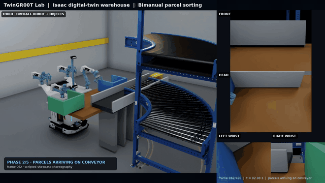
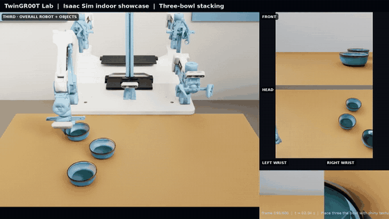
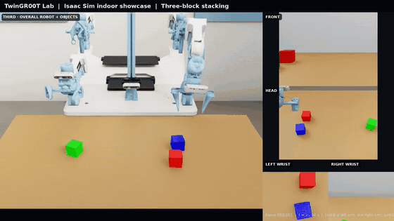
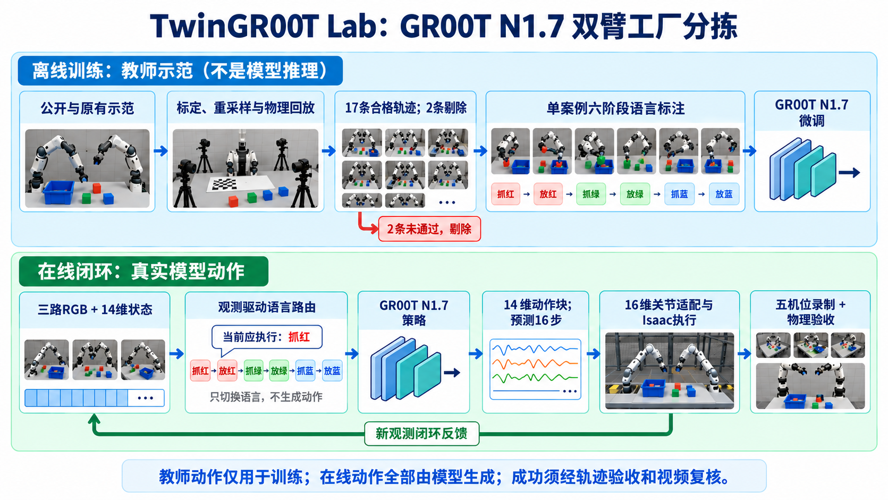
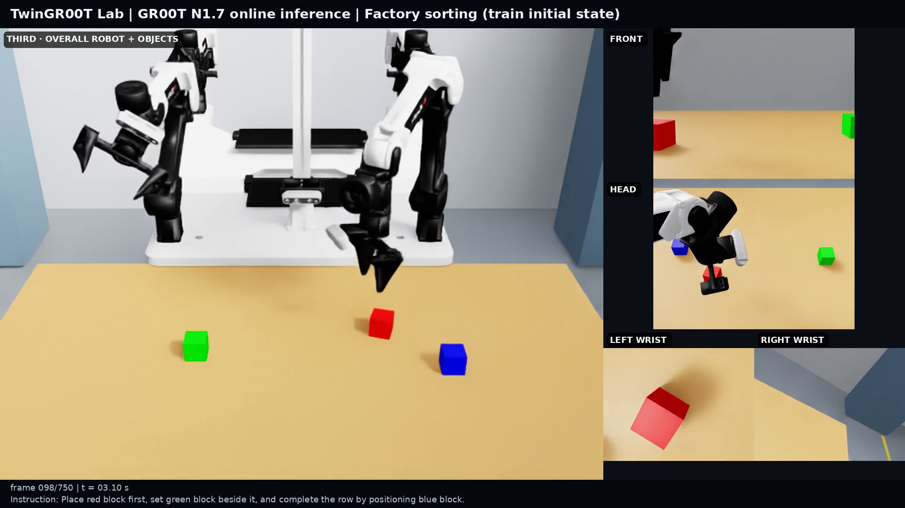
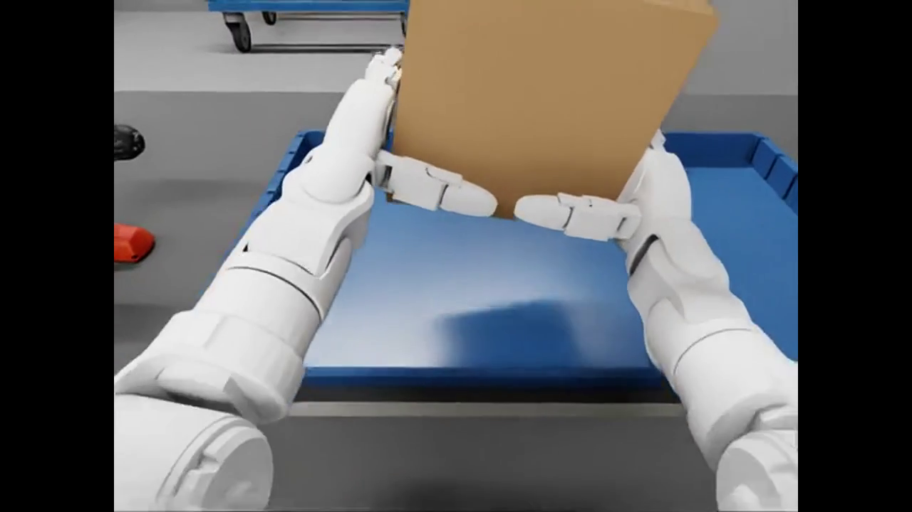
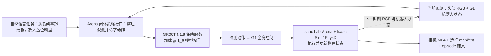

<div align="center">

# TwinGR00T Lab

**RoboTwin 2.0 × GR00T N1.7 × NVIDIA Isaac Lab**

An evidence-first toolkit for reproducible bimanual manipulation experiments,
contact-physics validation, and multi-camera digital-twin demos.

[](pyproject.toml)
[](docs/deployment.md)
[](docs/experiment-design.md)
[](CONTRIBUTING.md#quality-gates)
[](https://github.com/Erictianyufan)



[Quick start](#quick-start) · [Architecture](docs/architecture.md) ·
[Experiment protocol](docs/experiment-design.md) · [Deployment](docs/deployment.md) ·
[Contributing](CONTRIBUTING.md) · [Citation](CITATION.cff)

</div>

## What this repository provides

TwinGR00T Lab connects the RoboTwin task and demonstration format to an
Isaac Sim/Isaac Lab runtime, a 14-dimensional ALOHA action contract, an
optional GR00T N1.7 policy service, and machine-checkable experiment artifacts.
It is designed around one rule: a video is presentation evidence only after the
corresponding physics, task, and settling checks pass.

- **Reproducible data path:** audit RoboTwin HDF5 demonstrations and convert
  episode-disjoint splits to a GR00T-flavored LeRobot v2 dataset.
- **Dual-runtime isolation:** keep the Isaac simulator and GR00T dependencies in
  separate Python environments; use separate GPUs when available, or serialize
  training and online inference on a single GPU.
- **Contact-aware demos:** retain rigid-body dynamics, collision, friction,
  gravity, and post-release settling during verified manipulation.
- **Auditable outputs:** pair videos with JSON manifests and compressed traces
  containing actions, object motion, poses, and contact diagnostics.
- **Clear claim boundaries:** distinguish verified recorded-action replay from
  experimental GR00T inference and post-training.

## Demo gallery

<table>
  <tr>
    <td width="50%" align="center"><strong>Two-bowl stacking</strong></td>
    <td width="50%" align="center"><strong>Stable three-block stacking</strong></td>
  </tr>
  <tr>
    <td></td>
    <td></td>
  </tr>
</table>

The block demos are accepted only after an additional settling window verifies
centering, uprightness, linear speed, and angular speed. The warehouse demo
adds a continuous physical infeed: three dynamic parcels travel about 0.414 m,
stop at the pickup zone, and are sorted through finger collision and friction.
See [block stability](docs/block-stability.md) and
[parcel sorting](docs/parcel-sorting-demo.md) for the acceptance contracts.

## N1.7 双臂工厂分拣：训练与闭环验证中



上图是**生成的技术示意图，不是实验帧**。上半部分的教师重放仅用于训练；
下半部分是可作为正式视频来源的 N1.7 在线推理路径；六阶段路由只根据新观测
切换语言提示，不代替模型生成动作。新增 10 条公开示范
经 Isaac 物理重放后，8 条通过、2 条剔除；与原有 9 条合格教师轨迹合并为
17 条、12,890 帧的训练集。数据构建和验收边界见
[第九至十三轮实验说明](docs/n17-public17-factory-training.md)。此数据验收
**不代表模型已经完成任务**。

[早期 N1.7 框架设计图（历史方案，非实验结果）](docs/media/n17-framework-zh.png)

[](docs/media/n17_factory_online_partial_seed42.mp4)

[观看五机位、未剪辑的真实 N1.7 在线推理诊断视频](docs/media/n17_factory_online_partial_seed42.mp4)
（约 24 秒，checkpoint-2000，seed 42）。此轨迹局部抬起红、蓝块，但漏抓绿块且
最终放置不稳定，**未通过完整三块双臂分拣验收**；核验结果见
[对应验证记录](docs/evidence/n17-factory-stage4-partial/verify.json)。

这张图说明实际训练、在线推理和验收流程，**不代表已经获得 N1.7 成功 Demo**。
目前已完成时序对齐数据转换，并在单张 24 GB RTX 4090 上运行低显存后训练。
已检查的 200 步和后续 1,000 步版本没有通过抓取检查；再训练 4,000 步后，
模型已在闭环中抓起单块物体，但仍未完成三块双臂分拣和稳定放置。
目前已按相同工厂视角重新采集九条完整教师轨迹，另外保留一条不参与本段训练，
已完成 2,000 步补训；新工厂闭环抓起红、蓝块，但漏抓绿块且放置不稳定。
后续分别延长动作块执行长度、调整仿真关节变化率上限的两项单变量测试，也未通过完整任务验收。
现正保留九条数据的归一化，仅采样 demo0 进行 500 步单案例拟合；实际采样审计确认
510 个有效起点（0–509）各出现一次。500 步检查点已保存并通过结构核验，
新的工厂场景闭环录制已完成，但三块物体均未满足有效抓取条件，因此第五段未通过验收。
第六段针对绿块接近阶段追加采样并完成 1,000 步训练，真实闭环仍未形成三块有效抓取；
后续又对 17 条合格轨迹训练，并在单案例上测试六阶段语言路由：融合权重能抓放红块，
但绿、蓝块仍未完成。第十三轮抓绿过采样反而使红块抓取退化；逐项数值与限制见[第九至十三轮实验记录](docs/n17-public17-factory-training.md)。
截至目前没有可发布为 N1.7 完整任务成功的录像。
即使该案例后续通过，也不代表泛化成功率。
教师回放通过、训练 loss 下降、模型调用成功或生成 MP4 均不作为 N1.7 任务成功依据。

正式成果需要同一条轨迹通过：原始模型动作到执行动作的核验、双臂操作与物体抬起检查、
最终放置及稳定窗口检查，以及完整录像复核。去除工厂装饰的对照只用于诊断，不能替代工厂演示。
详细配置、失败记录、资源要求和复现命令见 [N1.7 训练与验收目标](docs/n17-training-goal.md)。

## G1 在线推理演示：纸箱从货架搬入蓝色料盘

[](media/g1_n16_live_success_cutdown.mp4)

点击上图观看 [20 秒双机位视频](media/g1_n16_live_success_cutdown.mp4)；另有
[未剪辑的机器人头部相机视频](media/g1_n16_head_rgb_episode0.mp4)。这是
**GR00T N1.6 `gn1_6` 权重的在线闭环推理**，不是录制动作回放，也不是本仓库
RoboTwin ALOHA 路线尚在实验中的 N1.7 结果。



这条闭环在每次仿真推进后重新取得观测，并由模型给出后续动作；视频由仿真相机录制，
成功判定来自独立保存的任务结果。此次只核验了 **seed 10 的一个完整 episode**：
第 1001 步 `success=true`、`overall_score=1.0`。不能把单次结果当成成功率，
也不能推断 N1.7 或 ALOHA 双臂任务已成功。查看
[运行说明与命令](docs/g1-n16-single-gpu.md)、
[原始 manifest](docs/evidence/g1-n16-20261022/run_manifest.json) 和
[episode 结果](docs/evidence/g1-n16-20261022/episode_results_rank0.jsonl)。

## Project framework

```mermaid
flowchart LR
    subgraph inputs ["Data and configuration"]
        demos[(RoboTwin HDF5)]
        taskConfig["Task configs"]
        isaacAssets["Isaac assets"]
    end

    subgraph preparation ["Preparation pipeline"]
        audit["Dataset audit"]
        conversion["LeRobot v2 conversion"]
        checkpoint["GR00T post-training"]
    end

    subgraph runtime ["Dual-GPU runtime"]
        arena["RoboTwin Arena"]
        simulator["Isaac Sim and PhysX"]
        replay["Recorded ALOHA replay"]
        bridge["Policy bridge"]
        policy["GR00T N1.7 server"]
    end

    subgraph validation ["Validation and delivery"]
        observations[(RGB state contacts)]
        metrics["Acceptance gates"]
        artifacts["MP4, GIF, JSON, NPZ"]
    end

    demos --> audit --> conversion
    conversion -.->|"Training data"| checkpoint
    checkpoint -.->|"Experimental"| policy
    taskConfig --> arena -->|"Launches task"| simulator
    isaacAssets --> simulator
    demos -->|"Verified actions"| replay -->|"Joint targets"| simulator
    simulator -.->|"RGB and state"| bridge
    bridge -.->|"Policy request"| policy
    policy -.->|"14-D action"| bridge
    bridge -.->|"Experimental targets"| simulator
    simulator --> observations --> metrics -->|"Accepted runs"| artifacts

    classDef verified fill:#d3f9d8,stroke:#2b8a3e
    classDef experimental fill:#fff3bf,stroke:#e67700
    class replay,simulator,metrics verified
    class checkpoint,bridge,policy experimental
```



Green nodes are on the currently verified presentation path. Yellow nodes are
implemented or planned experiment interfaces and must not be interpreted as a
validated GR00T result for the RoboTwin ALOHA route. The separate G1 N1.6
inference result above does not validate that ALOHA route. The detailed component and deployment view is in
[`docs/architecture.md`](docs/architecture.md).

## Evidence and project status

| Area | State | Evidence boundary |
|---|---|---|
| Bowl and block stacking | Verified replay | RoboTwin joint/gripper targets, Isaac physics, task success, post-settle checks |
| Warehouse parcel sorting | Verified replay | Physical conveyor traction, finger contacts, lift, hold, release, and settling traces |
| G1 shelf-to-bin box transfer | **Verified live GR00T N1.6 inference** | Official Isaac Lab-Arena G1 task, seed 10; one completed episode at step 1001, simulator `success=true` and `overall_score=1.0`. [Video](media/g1_n16_live_success_cutdown.mp4) · [raw head camera](media/g1_n16_head_rgb_episode0.mp4) · [run record](docs/g1-n16-single-gpu.md) |
| Dataset audit and conversion | Implemented | 14-D state/action contract, camera and episode consistency checks |
| GR00T N1.7 online ALOHA control | Experimental, task not yet completed | Model-generated actions have been executed in closed loop; checked episodes did not pass grasp/sorting acceptance |
| GR00T N1.7 post-training | Experimental | Default deployment reserves 40+ GB; the experimental single-24-GB Adafactor/BF16 path has completed training segments, not a successful task. [Configuration and evidence](docs/n17-training-goal.md) |
| G1 home-service composition | Experimental archive | Kept outside the accepted ALOHA-only showcase |
| RoboTwin Isaac Sim 6 / Isaac Lab 3 migration | Planned track | The separate G1 Arena result must not be pooled with the strict RoboTwin Sim 5.1 track |

The verified demo controller uses successful recorded RoboTwin targets. It does
**not** claim that GR00T produced the actions shown in the current GIFs. By
contrast, the linked G1 shelf-to-bin video came from online GR00T N1.6 model
inference, not the recorded ALOHA replay. The
research question and gates for making that claim are documented in
[`docs/experiment-design.md`](docs/experiment-design.md).

## Quick start

Dependency-light development and contract tests run without Isaac Sim:

```bash
git clone https://github.com/Erictianyufan/TwinGR00T-Lab.git
cd TwinGR00T-Lab
python -m venv .venv
source .venv/bin/activate
python -m pip install --upgrade pip
python -m pip install -e '.[dev]'
pytest
ruff check .
```

For the validated cloud layout—Ubuntu 22.04, two RTX 4090 GPUs, 128 GB RAM,
and about 500 GB disk—follow the
[`docs/deployment.md`](docs/deployment.md) runbook. Keep the simulator on GPU 0
and the policy service on GPU 1; two 24 GB cards do not become one 48 GB device
for GR00T post-training.

### Audit and convert a smoke episode

```bash
python -m pip install -e '.[data]'
twingr00t-audit vendor/RoboTwin/data/stack_bowls_three/data/demo_0.hdf5 \
  --output results/manifests/smoke-data.json

twingr00t-convert \
  --input-dir vendor/RoboTwin/data/stack_bowls_three \
  --output-dir data/lerobot/stack_bowls_three-smoke \
  --limit 1 --fps 31.25 \
  --manifest results/manifests/conversion-smoke.json
```

### Run the strict simulator smoke test

```bash
source /home/ubuntu/env_robotwin/bin/activate
python scripts/smoke_arena.py \
  --headless --device cuda:0 --steps 50 \
  --output results/manifests/arena-smoke.json \
  --environment manip_eval_tasks.examples.manipulation.stack_bowls_three_environment:StackBowlsThreeEnvironment \
  stack_bowls_three --embodiment aloha --enable_cameras True
```

Do not set `CUDA_VISIBLE_DEVICES` for Isaac Sim on the validated host; use
`--device cuda:0` so Vulkan and CUDA enumerate the same simulator GPU.

## Repository map

```text
assets/                  lightweight project-authored USD assets
configs/                 pinned versions and experiment configuration
docs/                    architecture, protocols, runbooks, and checkpoints
remote_overrides/        reviewed patches copied into upstream environments
scripts/                 bootstrap, rendering, evaluation, and audit entrypoints
src/twingr00t_lab/       data contracts, conversion, policy bridge, and metrics
tests/                   dependency-light unit and contract tests
artifacts/               ignored generated media and large runtime outputs
results/                 ignored or selectively versioned metrics and manifests
vendor/                  ignored upstream checkouts on the experiment host
```

Start with the [`docs/` index](docs/README.md). Large datasets, checkpoints,
videos, upstream repositories, and provider assets are intentionally excluded
from Git; compact showcase GIFs are the exception.

## Reproducibility and responsible use

- Record exact source commits, runtime versions, commands, seeds, and hardware.
- Keep train, validation, and test episodes disjoint; never split by frame.
- Never commit SSH passwords, Hugging Face tokens, cloud credentials, or model
  access tokens. Follow [`SECURITY.md`](SECURITY.md) if a secret is exposed.
- Treat simulation success as simulation evidence, not proof of safe real-robot
  deployment. Add hardware limits, emergency stops, and independent validation
  before transferring any policy to a physical robot.
- Respect the licenses and access terms of RoboTwin, NVIDIA models, simulator
  assets, robot descriptions, and every downloaded dependency.

## Author, citation, and license

TwinGR00T Lab is authored and maintained by
[Erictianyufan](https://github.com/Erictianyufan). GitHub contribution credit is
derived from commit authorship; scholarly/software citation metadata is provided
in [`CITATION.cff`](CITATION.cff).

No project license has been selected yet. Until a `LICENSE` file is added, the
repository is source-visible but does not grant general reuse, modification, or
redistribution rights. Upstream code, models, and assets remain subject to their
own licenses and terms.

**Built on NVIDIA Cosmos.** The N1.7 route uses
[NVIDIA GR00T-N1.7-3B](https://huggingface.co/nvidia/GR00T-N1.7-3B), whose model card
identifies Cosmos-Reason2-2B as its VLM backbone and links the
[NVIDIA Open Model License Agreement](https://www.nvidia.com/en-us/agreements/enterprise-software/nvidia-open-model-license/).
Model weights are not included in this source repository. This attribution does
not replace the separate terms for the G1 N1.6 checkpoint, RoboTwin data, or
simulator/robot assets, and does not imply NVIDIA endorsement of this project.
