# TwinGR00T Lab architecture

This document describes the project framework, runtime boundaries, and evidence
flow for the strict RoboTwin/Isaac Sim 5.1 track. Isaac Sim 6 and Isaac Lab 3
are a separate migration track and must not share result tables with this one.

## System framework

```mermaid
flowchart LR
    subgraph inputs ["Data and configuration"]
        demos[(RoboTwin HDF5)]
        taskConfig["Task configs"]
        isaacAssets["Isaac assets"]
    end

    subgraph preparation ["Preparation pipeline"]
        audit["Dataset audit"]
        conversion["LeRobot v2 conversion"]
        checkpoint["GR00T post-training"]
    end

    subgraph runtime ["Dual-GPU runtime"]
        arena["RoboTwin Arena"]
        simulator["Isaac Sim and PhysX"]
        replay["Recorded ALOHA replay"]
        bridge["Policy bridge"]
        policy["GR00T N1.7 server"]
    end

    subgraph validation ["Validation and delivery"]
        observations[(RGB state contacts)]
        metrics["Acceptance gates"]
        artifacts["MP4, GIF, JSON, NPZ"]
    end

    demos --> audit --> conversion
    conversion -.->|"Training data"| checkpoint
    checkpoint -.->|"Experimental"| policy
    taskConfig --> arena -->|"Launches task"| simulator
    isaacAssets --> simulator
    demos -->|"Verified actions"| replay -->|"Joint targets"| simulator
    simulator -.->|"RGB and state"| bridge
    bridge -.->|"Policy request"| policy
    policy -.->|"14-D action"| bridge
    bridge -.->|"Experimental targets"| simulator
    simulator --> observations --> metrics -->|"Accepted runs"| artifacts

    classDef verified fill:#d3f9d8,stroke:#2b8a3e
    classDef experimental fill:#fff3bf,stroke:#e67700
    class replay,simulator,metrics verified
    class checkpoint,bridge,policy experimental
```



### Reading the diagram

- **Solid edges** are data or control paths exercised by the current verified
  replay demos.
- **Dotted edges** are GR00T training or live-policy paths that remain
  experimental until the corresponding acceptance gates pass.
- **Green nodes** participate in the accepted physics-replay evidence path.
- **Yellow nodes** are implemented experiment interfaces, not validated learning
  claims.

## Component map

| Layer | Responsibility | Primary implementation | Current evidence state |
|---|---|---|---|
| Demonstration audit | Validate finite state/action values, camera groups, and dimensions | `src/twingr00t_lab/dataset.py` | Implemented and unit tested |
| Dataset conversion | Produce episode-aligned Parquet, H.264 camera streams, language metadata, and modality configuration | `src/twingr00t_lab/conversion.py` | Implemented and unit tested |
| Action contract | Map logical 14-D ALOHA actions to the 16-D Isaac gripper-joint interface | `src/twingr00t_lab/contracts.py` | Implemented and unit tested |
| Policy boundary | Build GR00T observations, serialize numeric messages, and map action chunks back to Isaac | `policy_bridge.py`, `policy_client.py` | Transport implemented; learning result pending |
| Simulation runtime | Launch RoboTwin Arena tasks, step Isaac Sim, and retain PhysX contact dynamics | `scripts/smoke_arena.py`, `scripts/replay_live_multiview.py` | Verified on the strict cloud runtime |
| Physical sorting demo | Feed dynamic parcels, replay ALOHA targets, record five cameras, and evaluate grasps | `scripts/parcel_sorting_physics_demo.py` | Verified replay artifact |
| Acceptance metrics | Check contact, lift, hold continuity, relative drift, arrival, and settling | `physics_grasp.py`, `parcel_sorting.py` | Implemented and unit tested |
| Experiment evidence | Store compact manifests, traces, and presentation media | `results/`, `artifacts/`, `docs/media/` | Generated per accepted run |

Paths in the table are relative to the repository root. Large `artifacts/`,
`results/`, datasets, checkpoints, and upstream checkouts are normally ignored;
only compact review assets and documentation are committed.

## Runtime isolation

| Compute role | Environment | Assignment | Purpose |
|---|---|---|---|
| Simulator | `/home/ubuntu/env_robotwin` | RTX 4090 GPU 0 | Isaac Sim 5.1, RoboTwin Arena, cameras, PhysX |
| Policy service | `/home/ubuntu/env_groot` | RTX 4090 GPU 1 | GR00T N1.7 inference process |
| Post-training | Separate job | One GPU with at least 40 GB VRAM | Reference GR00T post-training recipe |
| Migration study | `/home/ubuntu/env_isaaclab` | Isolated provider image | Isaac Sim 6.0.1 / Isaac Lab 3 compatibility |

The simulator and policy service communicate through a numeric-only policy
transport. This avoids importing GR00T, PyTorch, and its lockfile into the Isaac
runtime. It also makes latency, shape, and serialization failures observable at
a narrow boundary.

## Data and control contracts

The canonical ALOHA state/action vector is:

```text
[left_arm_6, left_gripper_1, right_arm_6, right_gripper_1]
```

The policy receives head, left-wrist, and right-wrist RGB, measured joint state,
and a language prompt. One-dimensional gripper commands are duplicated at the
simulator boundary to address the two physical gripper joints on each side.

For verified replay demos, recorded RoboTwin joint and gripper targets feed the
simulator directly. For the experimental policy path, observations are sent to
the GR00T service and returned action chunks are mapped through the same action
contract. This shared boundary enables a controlled replay-versus-policy
comparison without changing the task or acceptance checks.

## Evidence contract

An accepted presentation run should produce:

1. an MP4 or compact GIF for visual review;
2. a JSON manifest with command, versions, task, controller source, camera set,
   acceptance thresholds, and pass/fail results;
3. a compressed NPZ trace when contact-rich motion needs frame-level review;
4. a retained log for environment, dependency, or simulator diagnostics.

The video is not the acceptance oracle. Task predicates, physics traces, and
post-action settling determine whether a run can be described as verified.

## Claim boundaries

- The current gallery verifies RoboTwin recorded-action replay in Isaac physics.
- The parcel demo uses bounded tangential traction forces because the
  runtime-authored native surface-velocity API was not reliable in the validated
  Isaac Sim 5.1 GPU/Fabric configuration. Parcel poses are not animated.
- A passing policy-server transport smoke test does not establish that GR00T can
  complete a task.
- A GR00T result requires a frozen checkpoint, held-out episode evaluation,
  fixed prompts, success and safety metrics, and recorded latency.
- G1/humanoid compositions remain an experimental branch and are excluded from
  the accepted ALOHA-only showcase.

See [`experiment-design.md`](experiment-design.md) for the full gate definitions
and [`deployment.md`](deployment.md) for exact runtime versions and commands.
