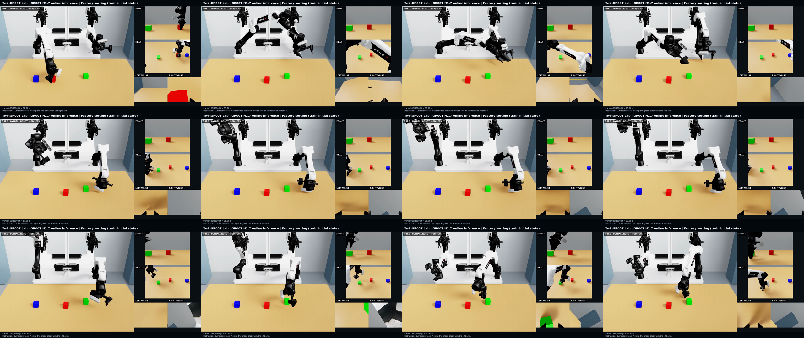

# N1.7 工厂双臂分拣：新增物理验收轨迹

本实验的目标是让 GR00T N1.7 根据语言、三路 RGB 和 ALOHA 状态，**在线闭环**完成红、绿、蓝三块物体的抓取与分拣。教师轨迹只用于训练，不能充当模型推理视频。

## 数据来源和准入

- 原有 Isaac 工厂教师轨迹：9 条，通过相同的抓取、双臂参与和稳定放置验收。
- RoboTwin 2.0 `blocks_ranking_rgb/aloha-agilex_clean_50` 公开包：从中取前 10 条，读取 HDF5/JSON，不加载 pickle。ZIP SHA-256 为 `3752a61e42081ce64e3d3d76b5634836904bced29007b6cec8f3bfa12b4d6387`。
- 对公开轨迹，根据首帧头部相机标定估计三色方块初始中心，将 30 Hz 的**实测关节状态**插值为 62.5 Hz 的候选关节目标。此步只是候选动作构建，不表示原 RoboTwin 动作命令已得到精确复现。
- 将候选轨迹放入同一 Isaac 工厂双臂场景物理重放，再由原始验收配置独立判断。公开轨迹中 0、1、2、3、5、7、8、9 号通过；4、6 号 `rejected_physics`，不得用于训练。公开新增 8 条 + 原有 9 条 = **17 条合格教师轨迹**。
- 验收证据是夹爪闭合邻域中的运动学抬升、双臂动作、三色目标位置和最终稳定窗口；**未使用直接力/接触传感器作为独立证据**。仍需逐帧视频复核，不应称作真机验证。

合并程序 `scripts/merge_accepted_factory_teachers.py` 对每条输入检查验收状态、默认物理阈值、HDF5/指令 SHA-256、动作帧数和三路相机帧数，并记录被拒绝的公开案例。教师 HDF5 与在线模型录制文件保留不同的 `controller_source` / `model_inference_result` 字段。

## 模型数据契约

合格轨迹转换为 LeRobot v2：17 个 episode、12,890 个训练帧、51 段三机位训练视频、62.5 Hz、14 维状态和动作。原 Isaac 记录采用后步观测与刚执行动作同帧，因此训练采用 `observation[i] -> action[i+1]`，每条轨迹丢弃末尾 1 帧。新 Isaac JPEG 已经是 RGB，**不再执行旧 RoboTwin JPEG 的 BGR 修正**。使用 N1.7 上游脚本计算该训练集的绝对与相对统计量。

## 本轮微调

单张 RTX 4090 24 GB，起点为已有 `n17-factory-v8-public-adapt/checkpoint-500`；仅训练 projector 与 action head，BF16、gradient checkpointing、Adafactor，batch 1 × 梯度累积 8，学习率 `1e-5`，状态丢弃率 0，关闭颜色抖动（其余空间增强沿用起点配置）。已完成 1,000 步，500 步存一个检查点；低显存路径是实验配置，不等同于上游推荐的 40 GB 训练配置。第 1,000 步完整权重的身份哈希为 `4b9e8a5f1f94f17962b999c668d50297fddf83b79c752d7b90e037f2d9249d44`，云机持久副本位于 `/home/ubuntu/model_checkpoints/n17-factory-public17-v9-step1000`。

## 第 1,000 步权重：在线闭环诊断

下列结果来自 **N1.7 在线推理**，每条均从对应训练示范的初始状态启动，但不读取其后续教师动作；每条执行上限 1,500 个 Isaac 控制步，策略每 8 步重新规划一次。验收采用与教师数据相同的运动学抓取、目标位置与稳定性条件，**不是直接接触传感器测量**。8 条初始场景均未通过完整任务：

| 训练场景编号 | 三色物体抓取证据（红/绿/蓝） | 三色最大抬升（米） | 完整任务 |
| --- | --- | --- | --- |
| 9 | 否/否/否 | 0.003 / 0 / 0 | 未通过 |
| 10 | 否/否/否 | 0 / 0 / 0 | 未通过 |
| 11 | 否/否/否 | 0 / 0 / 0 | 未通过 |
| 12 | 是/否/否 | 0.136 / 0.006 / 0 | 未通过 |
| 13 | 否/否/否 | 0 / 0 / 0 | 未通过 |
| 14 | 否/否/否 | 0 / 0 / 0 | 未通过 |
| 15 | 是/否/否 | 0.099 / 0.003 / 0 | 未通过 |
| 16 | 否/否/否 | 0.008 / 0.002 / 0 | 未通过 |

第 12 条的在线首帧三路相机与相应教师首帧平均像素差约为 3.31、2.58、2.52 / 255，说明该案例的初始图像基本对齐，失败不能简单归因于起点场景错位。其红块抬升证据仍不足以称为完成抓取放置。下一轮仅针对第 12 条做单案例过拟合诊断，保留完整数据集统计量；即使成功，也只能称为已见场景单次成功。

## 单案例训练及阶段化语言条件

第 10 轮从上面的第 1,000 步权重继续训练 800 步，只采样第 12 条轨迹的 1,019 个有效起点，其余 16 条仍留在数据集内提供**未改写的完整数据统计**。采样审计确认每个有效起点恰好出现一次；仅训练 projector 与 action head，学习率 `1e-5`。第 400 步在 1,800 步闭环中未形成三块有效抬升；第 800 步使用 8 步动作块时只抬起红块（最大 0.176 米）且未释放，使用 16 步动作块时红块最终放回桌面（最大抬升 0.330 米），但绿色和蓝色未被抓取，**两项均未完成任务**。这表明增加动作块执行长度改善了第一阶段，却没有解决后续阶段切换。

第 11 轮为单案例诊断增加六个语言子任务：抓红、放红、抓绿、放绿、抓蓝、放蓝。`scripts/build_n17_phase_dataset.py` 从**已验收**的第 12 条教师 HDF5 中读取物体抬升和对应夹爪释放时刻，生成逐帧语言标签；其阶段边界为 `[0,167), [167,269), [269,493), [493,589), [589,809), [809,1034)`。构建程序核对教师及物理报告哈希、Parquet 状态／动作／时间数值不变、视频硬链接不变；上游 LeRobot 读取器已检查能在每个边界取到正确提示。此操作只改训练语言标签，**不注入在线动作**。

线上可选的 `--phase-router` 从当前物体高度、手爪距离／开合与释放后稳定窗口选择下一句子任务提示；每一次 14 维动作仍由 N1.7 根据当前三路 RGB 和机器人状态实时预测，再映射到 Isaac 的 16 维关节目标。路由事件、每次模型调用使用的语言提示和原始模型动作都会保存，并由录制核验程序检查。它是**指定红绿蓝顺序及手臂分工的任务级路由**，不是开放式指令规划；即使该路线成功，也不能把单个训练场景演示写成跨场景泛化结果。

在线评估必须重新从初始状态生成观测、调用 N1.7 输出动作块，并由 Isaac 控制器执行；不得读取后续教师动作。只在同一条**真实策略轨迹**通过三色抓取、双臂参与、目标位置与释放后稳定窗口验收、且视频复核通过时，发布“完成任务”视频。若仅训练案例成功，应明确注明是训练案例的单次成功，不能外推为泛化成功率。

### 阶段条件对照结果

均从第 12 条训练场景起始状态出发，在线闭环执行 16 步动作块；表中的“抬升”是每块相对初始高度的最大值，不等于完整任务成功。第 11 轮训练使用短子任务提示；融合候选为 `0.7 × 第10轮第800步 + 0.3 × 第11轮第400步` 的参数插值，未使用教师动作回放。

| 权重 | 执行上限 | 最大抬升：红／绿／蓝（米） | 观测路由切换 | 完整任务 |
| --- | ---: | --- | --- | --- |
| 第 11 轮第 400 步 | 2,400 | 0.008／0.008／0 | 无 | 未通过 |
| 第 11 轮第 800 步 | 3,000 | 0.001／0／0 | 无 | 未通过 |
| 第 10／11 轮融合候选 | 3,000 | 0.136／0.001／0 | 第 126 步放红；第 316 步抓绿 | 未通过 |

前两项没有形成有效抓取；融合候选在画面与轨迹中完成红块抬升和释放，但绿块未被抓起，不能称为双臂分拣成功。第 12 轮改为保留原始完整任务指令，再附加当前阶段提示；数据构建器仍核对动作、状态、时间与视频不变。其闭环结果列于下表。

第 12 轮的同一起始场景闭环结果如下，均执行 3,000 控制步、预测并执行 16 步动作块。阶段切换由当前物体位置／速度、实测夹爪和末端位姿触发；「最近距离」为左末端至绿块的三维距离，不能替代抓取证据。

| 权重与动作范围设置 | 红／绿／蓝最大抬升（米） | 放红→抓绿切换步 | 左末端至绿块最近距离（米） | 完整任务 |
| --- | --- | ---: | ---: | --- |
| 上下文提示，第 200 步，机械臂范围余量 0.1 rad | 0.158／0.001／0 | 604 | 0.119 | 未通过 |
| 上下文提示，第 400 步，机械臂范围余量 0.1 rad | 0.182／0／0 | 417 | 0.137 | 未通过 |
| 上下文提示，第 200 步，机械臂范围余量 0.3 rad | 0.257／0／0 | 422 | 0.121 | 未通过 |

0.3 rad 对照只放宽了机械臂目标相对训练范围的裁剪，夹爪范围和逐步速度限制不变；它让红块抬升更高，但未改善绿块接触，因此不能把裁剪解释成唯一根因。Isaac 资产给出的机械臂软限位约为 ±10 rad，过于宽泛，**不能直接用作安全目标范围**。第 13 轮保持第 200 步上下文权重为起点、学习率 `5e-6`，在保留第 12 条轨迹全部 1,019 个有效起点的同时，对抓绿窗口 `[269,493)` 增加 1,120 个采样起点；选择审计状态为 `verified_single_episode_phase_focus`。该轮仍是单案例诊断，不能证明泛化或任务成功。

第 13 轮第 200 步权重完成保存，训练损失为 0.0120；但同一案例 3,000 控制步在线闭环**退化**：红／绿／蓝最大抬升为 0.0083／0／0 米，没有有效抓取，也没有进入下一语言阶段，验收状态 `task_not_completed`。因此训练损失和抓绿阶段采样数量都不能作为任务改善证据。保留此失败录像及原始动作记录仅用于诊断；不会把它称为正式成功 Demo。

为隔离过采样导致的旧技能遗忘，又做了一个**非训练**的参数插值对照：`0.8 × 第 12 轮第 200 步 + 0.2 × 第 13 轮第 200 步`。两端 1,030 个权重张量的分片映射和预处理配置一致，插值产生的临时权重只在内存盘用于推理；对照完成后已清理，可由两个持久化检查点和比例重建。相同工厂起始场景的 3,000 步闭环在第 145 步进入放红、第 671 步进入抓绿；红／绿／蓝最大抬升为 0.0774／0.00002／0 米，红块有抓取证据，绿、蓝块没有，最终稳定分拣仍失败。其未剪辑五机位视频仅为失败诊断，不是正式成功录像。

[观看本次完整五机位在线推理诊断录像](evidence/n17-factory-v12v13-blend02-failure/n17_public17_v12v13_blend02_router_e16_20261024_demo12.mp4)（约 50 秒）；[原始动作和物体状态 NPZ](evidence/n17-factory-v12v13-blend02-failure/n17_public17_v12v13_blend02_router_e16_20261024_demo12.npz)、[实验清单](evidence/n17-factory-v12v13-blend02-failure/n17_public17_v12v13_blend02_router_e16_20261024_demo12.json)、[独立核验结果](evidence/n17-factory-v12v13-blend02-failure/n17_public17_v12v13_blend02_router_e16_20261024_demo12.verify.json) 与首帧三路模型输入 PNG 一并保留。核验确认 1,500 帧视频完整、模型原始动作至执行动作可重建，但状态仍为 `task_not_completed`，人工抽帧也未见绿、蓝块抓取。

几何排查也校正了一个容易误判的细节：17 条教师轨迹中，筛选实际由左臂抓绿且末端接近绿块的 9 条，在绿块首次抬升前 5 帧，左末端参考点相对绿块的中位偏移约为 `(-0.007, +0.003, +0.135)` 米。插值闭环最近处约为 `(+0.007, -0.057, +0.134)` 米；其高度接近教师参考偏移，主要差异是约 6 厘米的横向位置。末端参考点并非指尖接触点，不能把 13 厘米高度差直接解释为“夹爪离物体过高”。这项对照只定位误差，不等于已有可靠的视觉估计或 DLS 修正器。
