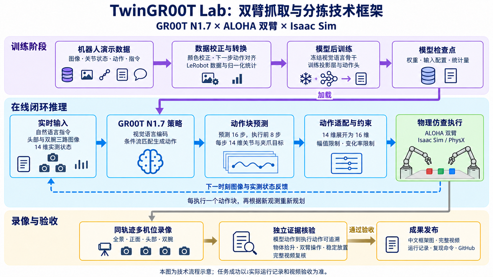

# N1.7 在线抓取与正式发布目标

状态：进行中（2026-10-24），尚无通过正式验收的 N1.7 完整分拣录像。

最终成果为 GR00T N1.7 驱动 ALOHA 双臂完成工厂分拣的在线闭环视频，以及中文技术框架图、可复现命令和物理验收证据。视频中的动作必须来自本轮观测条件下的模型预测。

## 训练与评估路线

1. 校正录制时序。现有 HDF5 在执行动作后记录状态与图像，因此新数据使用 `observation[i] -> action[i+1]`，逐轨迹裁尾，不跨轨迹拼接。保留原数据和原 checkpoint。
2. 在新目录重新编码 RGB、生成状态/动作统计与相对动作统计。对现有批次的关节位置和速度进行时间间隔诊断，结果支持约 16 ms 记录间隔，因此新元数据为 62.5 Hz。在线运行须同时记录实际 `env.step_dt`；视频帧率单独计算。
3. 从现存 RGB checkpoint-500 分段续训。首段 200 步、每 100 步保存，batch 1、梯度累积 8、Adafactor、BF16、梯度检查点、学习率 5e-5、state dropout 0。这是一张 24 GB RTX 4090 上的实验配置，是否可用以实际显存和梯度检查为准。
4. 先比较训练轨迹与留出轨迹的动作误差，再做闭环。检查点编号和训练 loss 不作为任务成功证据。若动作未抓住目标，分析输入、动作和物体轨迹后再调整训练。
5. 正式验收检查模型调用与执行动作的对应关系、物体抬起历史、双臂操作、最终目标排列与稳定窗口，并逐段视觉复核同一轨迹的完整视频。运动学证据不等同于直接的夹爪接触传感。
6. 成功后制作中文架构图，导出完整多机位视频，将 README、复现说明、模型版本和运行证据更新至 GitHub 主文档。失败诊断视频不得展示为已完成任务。

## 当前服务器工作目录

项目：`/home/ubuntu/mycode/robotwin-gr00t-aloha`

```bash
cd /home/ubuntu/mycode/robotwin-gr00t-aloha
bash scripts/train_n17_aligned_stage.sh
```

首段数据目录：`data/lerobot/blocks_ranking_rgb-aligned-v1`。

首段权重目录：`artifacts/checkpoints/n17-aligned-v1`。

首段运行日志：`results/logs/n17_aligned_stage1_20261023.log`。

完整训练集来自 `blocks_ranking_rgb-vision-batch` 的 source episode 0–8；留出场景和训练场景必须在结果中分别标注。后续发布需保存并核对训练、验证、测试的 source episode ID 和原始来源，不能只比较导出目录名。

## 2026-10-23 实际进展

- 首段 200 步训练完成，运行约 424 秒，观测显存约 20,380 MiB。
- `n17_aligned200_train0_20261023` 是真实模型在线诊断，不是成功成果。训练场景运行 1,500 控制步、188 次推理，没有满足抓取条件；红、绿方块未搬动，蓝方块最多发生约 5.5 cm 位移。
- 同一 checkpoint 的离线训练帧 0/50/100/200/300，16 步动作窗口混合维度 MAE 分别约 0.134/0.065/0.067/0.058/0.060。该指标混合弧度与米，不能解释为统一的物理误差，也不能替代闭环验收。
- 第二段从首段 checkpoint-200 加载权重，使用新优化器与调度器再训练 1,000 步，耗时约 1,860 秒、平均训练 loss 0.06147。输出 `artifacts/checkpoints/n17-aligned-v2/checkpoint-1000`，日志 `results/logs/n17_aligned_stage2_20261023.log`。
- 第二段在线评测 `n17_aligned1000_train0_20261023` 仍为 `task_not_completed`：1,500 控制步，没有满足抓取条件。不得把此次录像称为成功推理 Demo。训练帧重复三次推理的关节标准差约 0.031–0.054 rad，显示预测波动仍需降低。
- 正式录制证据升级到 schema 2：保存原始动作块、有效限幅边界、执行动作、物体与机器人实测状态、逐帧对应控制步、MP4 哈希和实际帧数。验收独立重算动作链路和抓取/稳定放置条件，最终还必须完成视频复核。

第二段复现命令：

```bash
BASE_MODEL_PATH="$PWD/artifacts/checkpoints/n17-aligned-v1/checkpoint-200" \
OUTPUT_DIR="$PWD/artifacts/checkpoints/n17-aligned-v2" \
MAX_STEPS=1000 SAVE_STEPS=500 SAVE_TOTAL_LIMIT=1 \
bash scripts/train_n17_aligned_stage.sh
```

训练脚本拒绝覆盖非空输出目录。以上记录只用于追踪训练与诊断，不是正式成功声明。

## 第三段：降低颜色增强并继续拟合

从第二段 checkpoint-1000 继续使用同一九条训练轨迹，新增 4,000 步；明确关闭亮度、对比度、饱和度、色相随机扰动，裁剪、旋转和网络 dropout 不变。此设置通过上游支持的 processor override 传入，训练完成后再次核验保存配置；不是仅修改一个无效的 model config 字段。每 1,000 步保存、保留四个阶段候选。尚未完成闭环验收，不能推断本段必然成功。

```bash
cd /home/ubuntu/mycode/robotwin-gr00t-aloha
export PYTHONPATH="$PWD/src:/home/ubuntu/mycode/robotwin-gr00t-lab/vendor/Isaac-GR00T-N1.7-src"
export NO_ALBUMENTATIONS_UPDATE=1 TOKENIZERS_PARALLELISM=false
/home/ubuntu/env_groot/bin/python scripts/launch_aloha_n17_lowmem.py \
  --dataset-path data/lerobot/blocks_ranking_rgb-aligned-v1 \
  --output-dir artifacts/checkpoints/n17-aligned-v3-coloroff \
  --base-model-path artifacts/checkpoints/n17-aligned-v2/checkpoint-1000 \
  --modality-config-path configs/groot_robotwin_aloha.py \
  --max-steps 4000 --save-steps 1000 --save-total-limit 4 \
  --batch-size 1 --gradient-accumulation-steps 8 \
  --optimizer adafactor --min-free-mib 22000 \
  --state-dropout-prob 0 --learning-rate 0.00005 --visual-augmentation color-off
```

日志：`results/logs/n17_aligned_stage3_coloroff_20261023.log`。

### 2026-10-24 第三段实际结果

4,000 步已完成，最终 checkpoint、分片载荷边界及实际颜色增强配置检查通过。两个固定种子在线诊断均完成 1,500 控制步、188 次策略调用，且独立验证了 N1.7 checkpoint、服务和每次动作响应的身份一致性，但均未完成三块物体的双臂分拣。

| 运行 | 抓取进展 | 未完成部分 |
| --- | --- | --- |
| `n17_coloroff4000_20261023_factory_train0` | 绿色块抬升 11.80 cm，持续 44 控制步满足近闭爪抬升条件 | 绿色块在错误位置释放；红、蓝块未抓起；最终未排列完成 |
| `n17_coloroff4000_20261023_no-factory-dressing_train0` | 蓝色块抬升 24.43 cm，持续 143 控制步满足近闭爪抬升条件 | 红、绿块未抓起；最终未排列完成；此场景仅用于诊断 |

以上均为训练初始场景，不是独立测试成功率。工厂录像中绿色块在约 2.064 秒收到模型逐步张爪的原始输出，约 2.320 秒落在错误位置；其放置阶段右臂目标未被位置裁剪。因此不能把此失败简单解释为底层限幅或夹爪随机滑落。五机位录像及完整动作/物体轨迹保留在对应的 `results/n17_factory/` 前缀下，状态仍为 `task_not_completed`。

离线训练帧 0/50/100/200/300 的第一步机械臂 MAE 约为 0.0292/0.0119/0.0198/0.0137/0.0173 rad，16 步平均误差更高，且部分夹爪阶段仍存在系统偏差。旧离线脚本给训练与留出轨迹使用同一条提示；留出源指令指定了不同的手臂顺序，因此旧留出逐关节误差不能单独用来判定泛化质量。新诊断须记录每条源轨迹各自的提示与来源。

后续对照 `n17_coloroff4000_exec2_train0_20261024` 已完成：同 checkpoint、工厂、初始状态、种子与安全界限，仅改为每次执行 2 步再观察；1,500 控制步、750 次推理，没有满足抓取条件。调用次数变化也会改变后续随机数流，不将其描述为逐调用相同噪声对照。另一组 `n17_coloroff4000_explicit_arms_train0_20261024` 改用来源指令中明确“左抓红、右抓绿、左抓蓝”的长指令、恢复执行 8 步，仍仅抓起绿色块，没有完成排序。两组模型身份与动作链路核验通过，任务核验失败。

更正指令后的密集离线检查为 `results/logs/n17_coloroff4000_dense_20261024.json`，包含三次抓取及释放阶段的 22 个观测位置、每位置 3 次预测。训练帧 52 的左夹爪第一步 MAE 约 11.44 mm，释放帧 124/437 约 12.17/12.51 mm；这些阶段误差不能用较低的全局关节平均误差替代。

教师 `demo_0` 的实际完整顺序为左臂红、右臂绿、左臂蓝，三块均抬高约 8 cm 并最终排齐。旧 HDF5 的左右 EEF 字段重复，且记录仅保留约 0.24 秒完整稳定尾段；这不是模型 14 维关节输入的左右错配，但不能用旧 EEF 字段直接认证新版双臂验收。工厂重采将按实际 `ee_frame` 名称重新获取左右末端，并在真实物理仿真中补录至少 1 秒末尾保持。此回放数据只用于训练，绝不作为 N1.7 推理视频发布。

## 第四段：工厂观测重采与补训

2026-10-24 已在与在线测试一致的工厂场景中，按原始动作完整重采 source episode 0–8，并分别保存实际左右末端、三路 RGB、动作与物体状态。九条训练轨迹均通过独立重算的默认三块抓取、双臂操作和稳定放置检查；每条末尾额外执行 63 个真实控制步（1.008 秒），不是复制静止帧。另行重采的 source episode 9 也通过数据检查，但不加入本段训练集。这些是教师回放生成的训练/诊断数据，**不是 N1.7 成功推理结果，也不代表泛化成功率**。

新图像由 Pillow 编为 RGB JPEG，不再执行旧数据的 BGR 交换。保持实际 62.5 Hz 和 `observation[i] -> action[i+1]`，重新计算绝对/相对动作统计量。训练流程已完成九条源数据哈希、完整动作、真实尾段和物理证据检查及数据转换，启动从第三段 checkpoint-4000 补训 2,000 步；完成后再做真实闭环复测。

```bash
cd /home/ubuntu/mycode/robotwin-gr00t-aloha
MAX_STEPS=2000 SAVE_STEPS=1000 nohup bash scripts/train_n17_factory_stage.sh \
  > results/logs/n17_factory_stage4_20261024.log 2>&1 < /dev/null &
```

以上命令用于首次创建新输出，不能重复覆盖已运行目录。新数据为 `data/lerobot/blocks_ranking_rgb-factory-aligned-v1`，输出为 `artifacts/checkpoints/n17-factory-v4`。训练/留出 HDF5 分别为 `data/replayed/blocks_ranking_rgb-factory-v1/data/demo_0.hdf5` 和 `data/replayed/blocks_ranking_rgb-factory-heldout-v1/data/demo_9.hdf5`。仍使用 batch 1、梯度累积 8、Adafactor、学习率 5e-5、state dropout 0、关闭颜色扰动，保留两个阶段 checkpoint。磁盘复核约剩 60 GiB，训练启动前通过至少 40 GiB 余量检查；GPU 上没有其他计算进程，无需停止其他项目。

本段后处理须使用 `EXPECTED_TRAINING_STEP=2000`，指向 `checkpoint-2000`，传入上述新训练/留出 HDF5、该数据目录的 `meta/stats.json`，并设置 `CORRECT_LEGACY_JPEG_BGR=0`。每条离线轨迹使用自己的来源指令，在线默认使用训练轨迹的来源指令；输入与指令来源保存到运行审计 JSON。是否成功仍由闭环抓取、完整放置和视频审查决定。

### 训练后的顺序诊断

`scripts/run_n17_posttrain_checks.sh` 等待指定训练进程退出，核对最终 checkpoint 步数、分片文件和实际颜色增强配置，再依次执行离线检查与两组在线录像。它不会把训练进程退出、录像完成或单纯的运动学通过当作正式成功，也不会自动发布结果。

- 两组均固定策略与仿真种子为 42，使用同一训练初始场景；分别为 `factory` 与 `no-factory-dressing`。后者仅移除新增工厂装饰，不代表已经重建原始采集环境，不能用于正式工厂验收。
- 每组保存三路实际传给策略的首帧 PNG、数值范围和文件哈希，用于排查颜色及图像输入问题。
- GPU 显存检查不通过时退出，不停止其他项目进程。最终仍需检查完整录像、独立验收，以及区分训练场景和留出场景。

### 正式验收固定标准与模型身份

正式验证使用项目默认的 `GraspAcceptanceConfig`，不接受运行记录中被修改或缺失的门槛配置；自定义阈值仅能用于诊断。验收测试包含仅抬升 1 mm 的反例，不能通过降低记录中的阈值将其改判为正式成功。

策略服务从实际加载对象读取 N1.7 架构、Cosmos-Reason2-2B 主干和本体标记，计算配置、processor、统计量及完整权重分片的 SHA256，返回 `model_identity`。录制器对本地指定检查点独立计算内容指纹并比较，每次动作响应必须绑定同一个身份 ID。manifest 保存该身份及每次调用的关联信息，验证器再检查一致性。这是可信本机流程中的复现证据，不是远程硬件证明，也不单独证明任务成功；仍须核验物理轨迹和完整录像。

2026-10-23 已完成云盘在线扩容：底层磁盘 450 GiB，根分区 ext4 文件系统显示约 436 GiB；扩容后核验约有 105 GiB 空闲。扩容未重启机器或中断训练，后续余量随 checkpoint 保存变化。

2026-10-24 运行环境复核：单张 RTX 4090（24,564 MiB），驱动 570.172.08；策略环境 Python 3.12.13、PyTorch 2.9.0+cu128，仿真环境 Python 3.11.15、Isaac Sim 5.1.0.0、Isaac Lab 包版本 0.47.3。NVIDIA Isaac-GR00T 检出提交为 `376ba890cff8c9de64d71d982772a9c36185fdd7`，工作区无修改；RoboTwin、Arena 和嵌套 Isaac Lab 提交分别与 `configs/versions.env` 的三项锁定值一致。本轮仍是单 GPU 低显存实验，不替代上游推荐配置。

## 中文技术流程图



图为流程示意，不是任务成功证据。使用内置图片工具生成；箭头经过修订，模型检查点加载到策略模块，录像必须通过验收后才能作为正式成果发布。生成提示与修订记录见 [图像提示词](media/n17-framework-zh.prompt.txt)。
